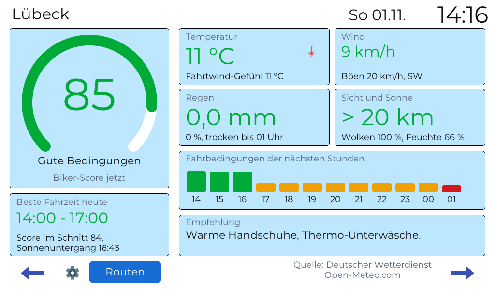
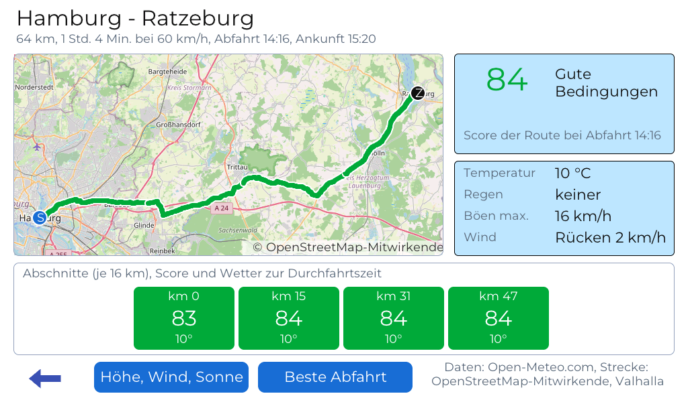

  <picture>
    <source media="(prefers-color-scheme: dark)" srcset="assets/logo/wettercube-biker-logo-hell.svg">
    
  </picture>

**Das Motorradwetter für den Schreibtisch: 7 Zoll, ESP32-P4, mit Routenwetter.**

> **🚧 Frühe Beta.** Funktionen, Bildschirme und Versionen können sich noch ändern, und die Motorradgebiete sind noch nicht ganz präzise. Aktuelles Moped- und Motorradwetter findest du auf [draussenwetter.de](https://draussenwetter.de).
>
> **⚠️ Kein Navigationsgerät, keine Haftung.** Der Score ist eine Orientierung nach eigenen Regeln, Prognosen sind unsicher, Warnungen des DWD gehen vor. Die Entscheidung zu fahren triffst du. Siehe die [Nutzungshinweise](https://wettercube.de/nutzungshinweise/).
>
> **🛠️ Softwareprojekt:** Das Gerät baust du selbst (Board kaufen, Firmware per USB aufspielen). Nur das Waveshare **ESP32-P4-WIFI6-Touch-LCD-7B** (1024×600) wird unterstützt.

**WetterCube Biker** zeigt das Wetter so, wie es ein Motorradfahrer braucht: einen **Biker-Score** von 0 bis 100 je Stunde und Tag, die **beste Fahrzeit**, Warnungen des Deutschen Wetterdienstes und vor allem das **Wetter entlang deiner Route** zur Zeit der Durchfahrt. Er entstand aus einem Abend, an dem die Frau am nächsten Tag zum Motorradtreffen wollte, siehe [Entstehung](https://wiki.wettercube.de/index.php/Biker/Entstehung).

  
  

## ✨ Das kann der Biker

- **Heute, Wetter und 7 Tage:** Score, beste Fahrzeit, Fahrtwind-Gefühl, Böen, Regen, Sicht, Ausrüstungs-Tipp; dazu ein Wetter-Bildschirm mit den nächsten vier Stunden und zwei wählbaren Kästen
- **Routen:** Start und Ziel eintippen (mit Vorschlägen) oder GPX-Datei laden, Wetter je Abschnitt zur Durchfahrtszeit, Gegen- und Seitenwind, Höhenprofil mit Frostgefahr, Blendung und Sonnenuntergang
- **Beste Abfahrt:** Score der Route für jede Stunde der nächsten 48 Stunden
- **Karte:** Strecke in Score-Farben auf OpenStreetMap, vom Gerät selbst gezeichnet
- **Motorradgebiete:** Rangfolge von Gebieten für heute, morgen und das Wochenende (grobe Orientierung, siehe Wiki)
- **Handy-Meldungen** über [ntfy](https://ntfy.sh): guter Fahrtag morgen, Regen in Kürze, neue DWD-Warnung
- **Bilderrahmen:** Fotos von der microSD-Karte statt Nacht-Uhr oder nach Leerlauf
- **Updates über WLAN** mit Rollback und Notfall-App

Alles Weitere, Bilder und die Erklärung der Berechnung: **[Wiki](https://wiki.wettercube.de/index.php/Biker/Start)** und [wettercube.de](https://wettercube.de).

## Datenquellen

Open-Meteo (nicht kommerziell), Deutscher Wetterdienst, OpenStreetMap (Karte), Valhalla beim FOSSGIS e. V. (Routen), Photon von komoot (Ortssuche). Kein Konto, keine Weitergabe durch den Entwickler. Einzelheiten und Pflichten: [CREDITS.md](CREDITS.md).

## Lizenz

Quellcode: [GNU AGPL 3.0](LICENSE) (kommerzielle Lizenz auf Anfrage), Texte und Bilder: CC BY-NC 4.0. Name und Logos sind nicht frei, siehe [NOTICE](NOTICE). Quellen und Lizenzen Dritter: [CREDITS.md](CREDITS.md).
